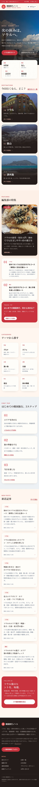

# 韓国旅行ノート — 韓国旅行メディア（正式名称）

> 本番URL: **https://sougakuhikaku.com/**（公開中・Cloudflare Pages）
> GitHub: **yuga-hashimoto/korea-affiliate-media**（Private）
> ステータス: **本番公開済み（2026-11-07）** / GSC 52 URL検出・GA4接続済み / CI・E2E検証済み

コーラル×コバルト、日本語主体＋韓国語アクセント、CC0写真で構成した、ソウル・釜山・済州の旅行メディアです。
エリアガイド、モデルコース、グルメ、カフェ、買い物、交通、宿泊、旅の準備を、公式情報の確認日時つきで紹介します。


## ドメイン再利用（実施済み）

`sougakuhikaku.com` は、もともと運営者自身が制作した「総額比較」サイト（ウォーターサーバー記事2件）が稼働していました。
ユーザーの明示承認（「旧サイトのデザイン・サイト・サーバーはすべて壊してよい。ドメインだけ使い回したい」）に基づき、
**2026-11-07 に Cloudflare Pages の既存プロジェクトへ新サイトを配信し、ドメインを再利用**しました。

- 比較エンジン・比較ページ・サンプル価格・`/go` 計測は廃止済みです。
- 旧サイトのコンテンツは上書きされ、旧ウォーターサーバー記事は404になっています。
- DNSレコードの変更は不要でした（カスタムドメインは既存プロジェクトに紐づいていたため）。
- 旧デプロイは Cloudflare のデプロイ履歴に残っていますが、旧サイトへの復帰は原則行いません。
- 詳細: [ADR-0004](docs/adr/0004-pivot-to-korea-travel-media.md) / [ADR-0005](docs/adr/0005-cloudflare-pages-deployment.md) / [ドメイン移行](docs/06_DOMAIN_MIGRATION.md)。

## 動作する機能（2026-11-06 時点）

- **ページ**: トップ、旅行ガイド、ソウル、釜山、済州島、グルメ、カフェ、買い物、韓国コスメ、韓国ファッション、交通、宿泊、旅の準備、記事一覧・記事詳細、編集方針、広告表記、運営者、プライバシー、問い合わせ。
- **記事**: 公開33本（ソウル7、宿泊1、釜山4、済州2、交通3、カフェ6、グルメ2、コスメ2、ファッション1、買い物1、旅の準備4）。AIによる追加下書きは `review` 状態で保持。
- **SEO**: ページ別metadata、canonical、OGP（1200×630）、sitemap.xml、robots.txt、JSON-LD（WebSite/Organization/Article/FAQPage/BreadcrumbList）。Previewはnoindex。
- **自動化**: AI記事下書き（品質ゲート付き）、鮮度監査、X投稿下書き、人手承認、署名付きWebhook配信（既定OFF）、日次/週次レポート、停止スイッチ。
- **配信**: Cloudflare Pages（静的書き出し）。管理画面は静的配信に含めず、レビューはCLIで行います。
- **旧URL**: `/korea/travel/esim` → 通信ガイド記事、`/korea/travel/airport-transport` → 空港アクセス記事、`/methodology` → 編集方針へ308転送。



## カテゴリ

| カテゴリ | パス | 内容 |
|---|---|---|
| ソウル | `/korea/travel/seoul` | エリア、モデルコース、ホテル選び |
| 釜山 | `/korea/travel/busan` | 海雲台・南浦洞、1泊2日 |
| 済州島 | `/korea/travel/jeju` | レンタカー旅、2泊3日 |
| グルメ | `/korea/food` | 食堂・屋台・コンビニ |
| カフェ | `/korea/cafe` | カフェ文化と注文 |
| 買い物 | `/korea/shopping` | 免税・タックスリファンド |
| 韓国コスメ | `/korea/beauty` | OLIVE YOUNG、持ち帰り |
| 韓国ファッション | `/korea/fashion` | サイズ・返品・関税 |
| 交通 | `/korea/travel/transport` | 空港アクセス・地下鉄・都市間 |
| 宿泊 | `/korea/travel/hotels` | エリアと予約前チェック |
| 旅の準備 | `/korea/travel/prepare` | 持ち物・通信・予算・季節 |

## ローカルでの確認

```bash
pnpm install
pnpm dev                              # http://localhost:3000
pnpm lint && pnpm typecheck && pnpm test && pnpm build
pnpm e2e                              # desktop + mobile 375px + axe
```

## 環境変数

`.env.example` を参照。秘密情報はコミットしません。

| 変数 | 用途 | 未設定時の挙動 |
|---|---|---|
| `OPENROUTER_API_KEY` / `OPENROUTER_MODEL` | AI記事生成 | モックで動作（公開しない） |
| `SOCIAL_WEBHOOK_URL` / `SOCIAL_WEBHOOK_SECRET` | X投稿の配信 | 送信しない |
| `SOCIAL_PAID_PARTNERSHIP_SUPPORTED` | Paid Partnership開示の保証 | false の間はPR投稿を自動配信しない |
| `AFFILIATE_LINKS_ENABLED` | 将来の成果リンク配信 | 未使用（承認後に実装） |
| `SITE_INDEXING_ENABLED` | index許可 | noindex |
| `NEXT_PUBLIC_SITE_URL` | canonical/OGPの基準URL | `http://localhost:3000` |
| `NEXT_PUBLIC_GA4_MEASUREMENT_ID` | GA4測定ID（公開値） | 計測タグを出力しない |

## 自動化（AI記事・X投稿）

```bash
pnpm jobs:article-draft      # トピックから下書き生成（キーなしはモック / review止まり）
pnpm jobs:social-draft       # 記事からX下書きを生成（needs_review）
pnpm social:approve --id ... --actor ...   # 人手承認
pnpm social:publish          # SOCIAL_PUBLISH_ENABLED=true + Webhook設定時のみ送信
pnpm jobs:audit              # 記事・出典の鮮度監査（更新候補の出力）
pnpm jobs:report             # 日次レポート（var/reports/）
pnpm jobs:weekly-report      # 週次レポート
pnpm dashboard               # ASP成果CSVを1ページに集約（ローカル専用・var/reports/）
```

- 生成物の公開は既定で停止しています（`CONTENT_AUTO_PUBLISH_ENABLED=false` / `SOCIAL_PUBLISH_ENABLED=false`）。
- 品質ゲート: Zodスキーマ、禁止表現、根拠のない数値、出典ID、広告開示。詳細は [AUTOMATION_RUNBOOK](docs/AUTOMATION_RUNBOOK.md)。
- CI: `.github/workflows/content-bot.yml` が毎日06:00 JSTに実行し、PRでレビューします。

## デプロイ（Cloudflare Pages）

```bash
# 本番
STATIC_EXPORT=true NEXT_PUBLIC_SITE_URL=https://sougakuhikaku.com SITE_INDEXING_ENABLED=true pnpm build
npx wrangler pages deploy out --project-name=sougakuhikaku --branch=main

# プレビュー
STATIC_EXPORT=true NEXT_PUBLIC_SITE_URL=https://sougakuhikaku.com SITE_INDEXING_ENABLED=false pnpm build
npx wrangler pages deploy out --project-name=sougakuhikaku --branch=preview
```

- 本番: https://sougakuhikaku.com / プレビュー: https://preview.sougakuhikaku.pages.dev
- セキュリティヘッダーは `public/_headers`、旧URLの転送は `public/_redirects`。
- CIからの配信は `.github/workflows/pages-deploy.yml`（手動実行・`CLOUDFLARE_API_TOKEN` が必要）。
- 詳細: [ADR-0005](docs/adr/0005-cloudflare-pages-deployment.md) / [PREVIEW_DEPLOY](docs/PREVIEW_DEPLOY.md)。

## ドキュメント一覧

| ファイル | 内容 |
|---|---|
| [AGENTS.md](AGENTS.md) | AIエージェントの全体ルール、安全な承認ゲート |
| [AI_MASTER_PROMPT](docs/AI_MASTER_PROMPT.md) | AIへ作業を委任するマスタープロンプト |
| [ADR-0001](docs/adr/0001-content-migration.md) | 既存サイトとの共存・移行方針 |
| [ADR-0002](docs/adr/0002-tech-stack.md) | 技術スタック・ホスティング・コスト |
| [ADR-0003](docs/adr/0003-content-automation.md) | AI生成・X投稿の自動化と承認ゲート |
| [ADR-0004](docs/adr/0004-pivot-to-korea-travel-media.md) | 比較エンジン廃止と旅行メディアへの転換 |
| [ADR-0005](docs/adr/0005-cloudflare-pages-deployment.md) | Cloudflare Pagesへの静的配信とドメイン再利用 |
| [06_DOMAIN_MIGRATION](docs/06_DOMAIN_MIGRATION.md) | 既存サイトの保全、DNS/公開、復旧 |
| [07_RELEASE_OPERATIONS](docs/07_RELEASE_OPERATIONS.md) | 環境、Secrets、CI/CD、運用 |
| [08_IMPLEMENTATION_BACKLOG](docs/08_IMPLEMENTATION_BACKLOG.md) | バックログ（旅行メディア版を追記） |
| [10_QA_ACCEPTANCE](docs/10_QA_ACCEPTANCE.md) | テスト計画と受入基準 |
| [11_COMPLIANCE](docs/11_COMPLIANCE.md) | 広告表示、著作権、個人情報 |
| [AUTOMATION_RUNBOOK](docs/AUTOMATION_RUNBOOK.md) | 記事生成・X投稿の運用手順 |
| [AFFILIATE_APPLICATION](docs/AFFILIATE_APPLICATION.md) | ASP登録の準備・手順・必要な情報 |
| [AFFILIATE_LINKS_SETUP](docs/AFFILIATE_LINKS_SETUP.md) | 成果リンクの設定・デプロイ手順 |
| [PREVIEW_DEPLOY](docs/PREVIEW_DEPLOY.md) | Preview環境のデプロイ手順 |
| [CREDITS](docs/CREDITS.md) | 使用写真・フォントの出典とライセンス |
| [PROGRESS](docs/PROGRESS.md) | 作業ログ、テスト結果、残課題 |
| [.env.example](.env.example) | 秘密情報を含まない設定キー一覧 |

## 未実施・承認待ち

- ASP申請・規約同意・成果リンク（手順は [AFFILIATE_APPLICATION](docs/AFFILIATE_APPLICATION.md)）、Buffer公式API接続。
- GSCのサイトマップ再送信・所有確認（ユーザー権限）。
- 運営者情報・お問い合わせ窓口・特商法表記の確定。
- 正式ブランド名の決定（暫定: 韓国旅行ノート）。

## 方針

本番は Cloudflare Pages の静的配信です。サーバーサイド処理が必要になった場合は Workers（OpenNext）等へ移行します。
月額30万円は**確定アフィリエイト報酬（税・経費控除前）の長期目標**であり、保証ではありません。
営業時間・料金・交通は変動するため、確認日時と公式情報へのリンクを明記し、未確認の情報は掲載しません。
AI生成の記事は公開前にレビューし、現地体験を装う表現や根拠のない断定は行いません。
