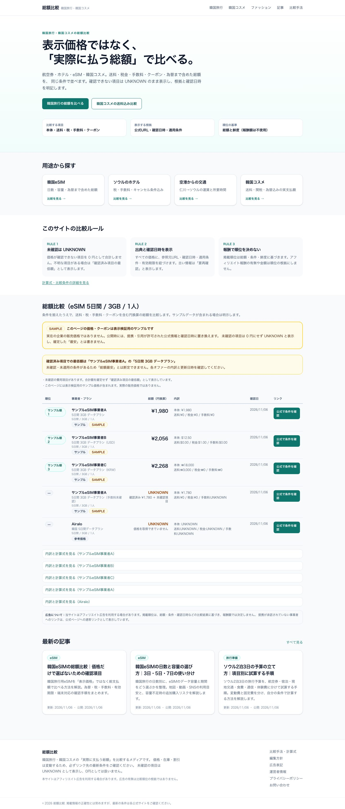

# 総額比較 — 韓国旅行・韓国コスメの総額比較メディア

> 本番ドメイン候補: **https://sougakuhikaku.com/**  
> GitHub: **yuga-hashimoto/korea-affiliate-media** （Private）  
> ステータス: **MVP実装・自動化パイプライン・CI/E2E検証済み（2026-11-06）** / 本番公開は未承認

韓国旅行・ホテル・交通・eSIM、韓国コスメ・ファッションの**実際に支払う総額**を比較し、日本人が選びやすい情報メディアをAI主体で構築する。特定芸能グループへの依存は初期対象外。Xアカウント @bts_95_y を初期の集客チャネルとし、検索流入の独立したサイト資産を育てる。

## 重要：既存ドメインに公開サイトが存在する

2026-11-06に https://sougakuhikaku.com/ で現行の「総額比較」サイト（ウォーターサーバー記事2件、サイトマップ8 URL）を確認。**DNSや現行サイトを未保全のまま上書きしない。** 既存コンテンツ/URL/検索流入の棚卸し・バックアップ・移行計画を [ドメイン移行計画](docs/06_DOMAIN_MIGRATION.md) に明記した。ドメイン切替はユーザー明示承認後。

## AIに開発を任せるには

1. AIコーディングエージェントでこのリポジトリを開く。
2. **[AIマスタープロンプト](docs/AI_MASTER_PROMPT.md)** を最初に読み込ませ、その指示で実装を開始する。
3. [AGENTS.md](AGENTS.md) に従い、[実装バックログ](docs/08_IMPLEMENTATION_BACKLOG.md) を依存順に進める。
4. 仕様に不明点があっても、プレビューMVP・テストなど安全な作業を先に進める。不可逆な変更/契約/課金/本番DNS/PRのX公開には明示承認が必要。
5. 実装やテストの結果を [進捗](docs/PROGRESS.md) に記録。

[エージェントへの短い実行指示](docs/12_AGENT_HANDOFF.md) も用意。



## 動作する機能（2026-11-06 時点）

- 総額比較エンジン: 税込/税別、送料、手数料、クーポン（閾値・上限・会員・期限）、外貨の円換算、UNKNOWNの非ゼロ扱い、条件不一致時の順位付け停止。
- 比較ページ: トップ、韓国旅行、eSIM、ホテル、空港交通、韓国コスメ、ファッション（データ未取得時の空状態）、記事一覧・詳細、比較手法、編集方針、広告表記、運営者、プライバシー、問い合わせ。
- SEO: ページ別metadata、canonical、OGP（1200×630画像）、sitemap.xml、robots.txt、JSON-LD（WebSite/Article/FAQPage/BreadcrumbList）、Previewのnoindex。
- 計測: `/go/<offerId>` のallowlistリダイレクト、匿名クリックJSONL、ASP成果CSVの集計（見込/確定/却下/返金の分離）。
- 自動化: AI記事下書き（品質ゲート付き）、X投稿下書き、人手承認、署名付きWebhook配信（既定OFF）、日次/週次レポート、停止スイッチ。
- 管理画面（`ADMIN_UI_ENABLED=true` のときのみ）: `/admin`, `/admin/promotions`, `/admin/articles`, `/admin/affiliates`。

## 必要なシークレット / 設定

| 変数 | 用途 | 未設定時の挙動 |
|---|---|---|
| `OPENROUTER_API_KEY` / `OPENROUTER_MODEL` | AI記事生成 | モックで動作（公開しない） |
| `SOCIAL_WEBHOOK_URL` / `SOCIAL_WEBHOOK_SECRET` | X投稿の配信 | 送信しない（blocked） |
| `SOCIAL_PAID_PARTNERSHIP_SUPPORTED` | Paid Partnership開示の保証 | false の間はPR投稿を自動配信しない |
| `AFFILIATE_LINKS_ENABLED` | 成果リンク配信 | 公式リンクのみ |
| `INGESTION_FEED_URL` / `INGESTION_ALLOWED_HOSTS` | 許諾フィード取り込み | 取り込まない |
| `FX_API_URL` / `FX_API_KEY` / `FX_ALLOWED_HOSTS` | 為替更新 | 更新しない（サンプルのみ） |
| `DATABASE_URL` | 将来のDB接続 | 未使用（ファイル保存） |
| `CLICK_HASH_SALT` | クリック匿名化 | 開発用ソルト（本番では必ず設定） |
| `SITE_INDEXING_ENABLED` | index許可 | noindex |
| `NEXT_PUBLIC_DEMO_MODE` | サンプル価格の表示 | 本番ビルドでは非表示 |

## 本番切替手順（未実施・承認必須）

1. 既存サイト8 URLのバックアップ、DNSレコードの控え、GSC/GA4の現状記録。
2. 旧URLの扱い（共存・アーカイブ・301）をGSCデータに基づいて決定。
3. 本番ビルドをVercel等へデプロイし、`SITE_INDEXING_ENABLED=true`・`NEXT_PUBLIC_DEMO_MODE=false` を確認。
4. DNS切替（A/CNAMEのみ。MX/TXTは触らない）→ HTTPS/主要URL/robots/sitemap/計測のスモーク。
5. 問題時は旧デプロイとDNSに戻す。詳細は [ドメイン移行計画](docs/06_DOMAIN_MIGRATION.md)。

## 未完事項

- 外部Preview（Vercelトークン未設定）、実ASPリンク・報酬データ、Buffer公式API接続、GA4/GSC実データ、既存サイトの実バックアップ、本番DNS切替。
- 条件入力によるインタラクティブ比較、週次の通知連携、DB移行（PostgreSQL）。
- 運営者情報・お問い合わせ窓口・特商法表記は本番公開前に確定が必要。

## ドキュメント一覧

| ファイル | 内容 |
|---|---|
| [AGENTS.md](AGENTS.md) | AIエージェントの全体ルール、安全な承認ゲート |
| [AI_MASTER_PROMPT](docs/AI_MASTER_PROMPT.md) | 全作業をAIへ委任するコピペ用のマスター指示 |
| [00_PROJECT_CHARTER](docs/00_PROJECT_CHARTER.md) | 事業目標と対象、現サイトの観測結果 |
| [01_PRD](docs/01_PRD.md) | 要件定義、ページ設計、受入条件 |
| [02_ARCHITECTURE](docs/02_ARCHITECTURE.md) | 技術構成、DB、比較計算式、API、CI |
| [03_CONTENT_SEO](docs/03_CONTENT_SEO.md) | 記事計画、SEO、X集客 |
| [04_AFFILIATES](docs/04_AFFILIATES.md) | 提携候補、成果集計、審査/広告リンク管理 |
| [05_AUTOMATION](docs/05_AUTOMATION.md) | 収集→検証→AI草案→審査→配信→計測 |
| [06_DOMAIN_MIGRATION](docs/06_DOMAIN_MIGRATION.md) | 既存サイトの保全、SEO、DNS/公開、復旧 |
| [07_RELEASE_OPERATIONS](docs/07_RELEASE_OPERATIONS.md) | 環境、Secrets、CI/CD、日常運用、費用上限 |
| [08_IMPLEMENTATION_BACKLOG](docs/08_IMPLEMENTATION_BACKLOG.md) | AI向けP0〜P5の全タスク |
| [09_KPI_MODEL](docs/09_KPI_MODEL.md) | 目標月30万円のアクセス・成約・報酬試算 |
| [10_QA_ACCEPTANCE](docs/10_QA_ACCEPTANCE.md) | 単体/統合/E2E/SEO/本番受け入れ |
| [11_COMPLIANCE](docs/11_COMPLIANCE.md) | 広告表示、X/Google、著作権、個人情報 |
| [12_AGENT_HANDOFF](docs/12_AGENT_HANDOFF.md) | AI開発エージェントへの最短引き継ぎ |
| [13_UI_CONTENT_DESIGN](docs/13_UI_CONTENT_DESIGN.md) | UI/UXと比較コンポーネント |
| [14_DECISIONS_AND_OPEN_ITEMS](docs/14_DECISIONS_AND_OPEN_ITEMS.md) | 仮の技術判断と未確定項目/ADR |
| [ADR-0001](docs/adr/0001-content-migration.md) | 既存サイトとの共存・移行方針 |
| [ADR-0002](docs/adr/0002-tech-stack.md) | 技術スタック・ホスティング・コスト |
| [ADR-0003](docs/adr/0003-content-automation.md) | AI生成・X投稿の自動化と承認ゲート |
| [PREVIEW_DEPLOY](docs/PREVIEW_DEPLOY.md) | Preview環境のデプロイ手順 |
| [AUTOMATION_RUNBOOK](docs/AUTOMATION_RUNBOOK.md) | 記事生成・X投稿・取り込みの運用手順 |
| [PROGRESS](docs/PROGRESS.md) | 作業ログ、済/未着手 |
| [.env.example](.env.example) | 秘密情報を含まない設定キー一覧 |

## MVPのページ構成

- トップ、韓国旅行の総額比較、ホテルエリア比較、eSIM比較、韓国コスメ送料込み比較、記事一覧・詳細
- 比較条件と内訳（税/送料/手数料/クーポン/為替）、一次情報と確認日時、UNKNOWNの明示
- 比較手法、編集方針、広告表記、運営者、プライバシー、問い合わせ
- 提携承認後の広告リンク、匿名クリック計測、成果集計
- AIが生成した記事/X投稿のレビューキュー、投稿停止スイッチ

## 事業目標・注意点

月額30万円は**確定アフィリエイト報酬（税/経費控除前）の長期目標**。必要アクセス数や成約率は仮定で、予測・保証ではない。事実に基づく総額比較がサイトの競争優位性。大量の低品質なAI記事、無許可スクレイピング、架空のレビュー/価格、ステルスマーケティングは禁止。

## 現状

- [x] GitHubリポジトリ作成
- [x] ドメイン公開状態の読み取り確認
- [x] AI向け実装計画・マスタープロンプト・運用/移行計画
- [x] Next.js/TypeScript/Tailwind の実装、比較エンジン、SEO、テスト、GitHub Actions
- [x] ローカルPreviewビルドとE2E（desktop / mobile 375px）
- [x] AI記事・X投稿の下書き生成パイプライン（品質ゲート付き・既定はレビュー必須）
- [ ] Vercel等へのPreviewデプロイ（アカウント連携が必要）
- [ ] 提携審査/実リンク/本番DNS切替（承認後）

## ローカルでの確認

```bash
pnpm install
NEXT_PUBLIC_DEMO_MODE=true pnpm dev   # サンプルデータを表示
pnpm lint && pnpm typecheck && pnpm test && pnpm build
pnpm e2e                              # desktop + mobile 375px
```

- サンプル価格は `NEXT_PUBLIC_DEMO_MODE=true` のときだけ表示されます。`pnpm build`（本番相当）では表示されません。
- Preview/ステージングは `SITE_INDEXING_ENABLED=false`（既定）で全面 `noindex` です。
- 環境変数は [.env.example](.env.example) を参照。秘密情報はコミットしません。

## 自動化（AI記事・X投稿）

```bash
pnpm jobs:article-draft      # トピックから下書き生成（キーなしはモック / review止まり）
pnpm jobs:social-draft       # 記事からX下書きを生成（needs_review）
pnpm social:approve --id ... --actor ...   # 人手承認
pnpm social:publish          # SOCIAL_PUBLISH_ENABLED=true + Webhook設定時のみ送信
pnpm jobs:report             # 日次レポート（var/reports/）
pnpm jobs:weekly-report      # 週次レポート
pnpm jobs:ingest             # 許諾済みフィードの取り込み（既定OFF）
```

- 生成物の公開は既定で停止しています（`CONTENT_AUTO_PUBLISH_ENABLED=false` / `SOCIAL_PUBLISH_ENABLED=false`）。
- 品質ゲート: Zodスキーマ、禁止表現、根拠のない数値、出典ID、広告開示。詳細は [AUTOMATION_RUNBOOK](docs/AUTOMATION_RUNBOOK.md)。
- CI: `.github/workflows/content-bot.yml` が毎日06:00 JSTに実行し、PRでレビューします。

## デプロイ

- Preview: [PREVIEW_DEPLOY](docs/PREVIEW_DEPLOY.md)（Vercelトークン未設定時はワークフローが自動スキップ）。
- 本番: `sougakuhikaku.com` のDNS切替は**未実施**。既存サイトのバックアップ・GSC確認・ユーザー承認後に別途実施します。
